# Query Studio documentation

These guides describe the application implemented in this repository. Start with the [architecture overview](./architecture.md) to understand the system, or choose a guide for the task at hand.

## Find the right guide

| I want to…                                          | Read                                                                       | Diagram                                                                      |
| --------------------------------------------------- | -------------------------------------------------------------------------- | ---------------------------------------------------------------------------- |
| Install, configure, or seed the app                 | [Project README](../README.md)                                             | [Setup and checks](../mermaid/rendered/07-testing-operations.svg)            |
| Understand the system and its design choices        | [Architecture](./architecture.md)                                          | [System map](../mermaid/rendered/01-architecture.svg)                        |
| Follow the app from interaction to response         | [Mermaid diagram library](../mermaid/README.md)                            | [Whole-app flow](../mermaid/rendered/00-overall.svg)                         |
| Change components, hooks, or result rendering       | [Frontend and rendering](./frontend.md)                                    | [Workspace](../mermaid/rendered/02-frontend.svg)                             |
| Change model orchestration or MCP tools             | [Query agent and tools](./query-agent.md)                                  | [Assistant flow](../mermaid/rendered/03-query-agent.svg)                     |
| Follow MCP tools across multiple chat turns         | [Illustrated MCP flow](./mcp-flow.md)                                      | [Multi-turn conversation](../mermaid/rendered/13-multi-turn-query-agent.svg) |
| Trace MCP execution and understand its limits       | [Tool lifecycle and safeguards](./mcp-flow.md#follow-one-turn-through-mcp) | [MCP tool lifecycle](../mermaid/rendered/14-mcp-tool-lifecycle.svg)          |
| Understand SQL policy, caching, or exports          | [Database and result data](./database.md)                                  | [Database reads](../mermaid/rendered/04-database.svg)                        |
| Integrate with HTTP or WebSocket endpoints          | [Transport and APIs](./transport-api.md)                                   | [Requests and responses](../mermaid/rendered/05-transport-api.svg)           |
| Understand the public demo and read-only safeguards | [Public demo and read-only safeguards](./security.md)                      | [Read-only safeguards](../mermaid/rendered/06-security.svg)                  |
| Run checks, deploy, or diagnose failures            | [Testing and operations](./testing-operations.md)                          | [Running the app](../mermaid/rendered/07-testing-operations.svg)             |
| Edit the agent's prompt files                       | [Prompt authoring guide](../src/lib/server/agent/prompts/README.md)        | [Instructions and models](../mermaid/rendered/12-prompts-and-models.svg)     |

## Visual overview

The browser handles interaction, the app server coordinates the work, and PostgreSQL and the AI provider supply data and model responses.

Open the image at full size, or follow [one question in time order](../mermaid/rendered/08-end-to-end-sequence.svg). The [diagram library](../mermaid/README.md) includes editable Mermaid sources and focused views of cancellation, caching, and result handling.

## Scope and terminology

- **Active workspace:** the schema explorer and natural-language chat shown on the home page.
- **Retained manual path:** SQL editor components that are not mounted in the workspace. Their HTTP endpoints remain reachable.
- **Turn:** one question and its response, handled by one WebSocket connection.
- **Snapshot:** the rows loaded for a turn, capped at 1,000; sorting, paging, and browser CSV export use that snapshot.
- **MCP:** Model Context Protocol. Here, its client and tool server communicate inside the same Node.js process.

These guides document current behavior; they are not a record of completed audit or deployment certification.

## Keep the docs accurate

When behavior changes, update the owning guide and any affected API examples, limits, diagrams, or links. Use the implementation and tests as the source of truth. Label proposed changes as proposals; do not describe them as shipped features.

For consistent, accessible Markdown previews:

- Use one page title, sequential heading levels, and descriptive link text.
- Keep paragraphs short. Use numbered lists for procedures and tables for comparisons or contracts.
- Label fenced code blocks with a language. Keep examples copyable and free of credentials.
- Give diagrams meaningful alt text and explain the flow in adjacent prose. Avoid meaning conveyed only by color.
- Keep tables compact; put long examples in code blocks outside tables.
- Use relative links to source files rather than line numbers that drift after edits.

Check the rendered preview at normal and narrow widths, as well as local links and formatting. The [documentation checks](./testing-operations.md#documentation-checks) describe the review workflow.
