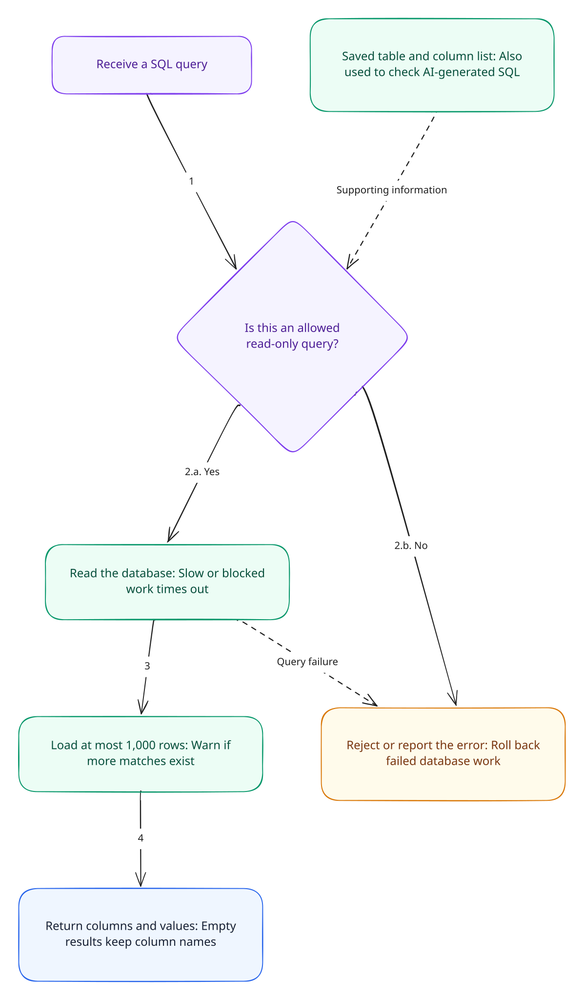

# Database and result data

This guide covers schema discovery, the SQL execution policy, and the result snapshot shared by the UI and APIs.

[Documentation home](./README.md) · [Transport and APIs](./transport-api.md) · [Public demo and read-only safeguards](./security.md)

**On this page:** [Schema cache](#schema-discovery-and-cache) · [SQL policy](#sql-policy) · [Execution](#query-execution) · [Result contract](#result-contract-and-display) · [CSV](#csv-behavior)

## Connection pool and startup

`getDatabase` creates a Sequelize PostgreSQL instance on demand and stores it in a process-global map keyed by the connection URL. This allows reuse during Next.js development reloads. The pool is configured with a maximum of 10 connections, bounded acquisition/connection timeouts, and disabled SQL logging.

`server.ts` prepares Next.js, calls `initializeDatabase`, then opens the HTTP server. Initialization authenticates the pool and reads the database schema before accepting requests. Authentication retries three times after the initial attempt, with one-second delays. A failure rejects startup; a failed initialization promise is removed so it can be retried later.

Do not put database credentials in browser-visible variables. Environment and dataset setup are described in the root README.

## Schema discovery and cache

`database-schema.sql` reads PostgreSQL catalogs to enumerate relations the current database role can use: ordinary and partitioned tables, views, materialized views, and foreign tables. It returns relation schema/name, columns and formatted types, nullability/default, and constraints. System schemas are excluded; the role must have schema usage and `SELECT` privilege.

`getDatabaseSchema` caches a complete successful snapshot in a process-global `WeakMap` keyed by the Sequelize instance. Concurrent reads coalesce on one pending promise. Refresh replaces the snapshot only after a full successful catalog read; a failed refresh retains the preceding successful value. The schema text used by the agent includes quoted identifiers and constraints, and the helper also builds a short set of sample-query suggestions. The public schema endpoint returns table metadata, not the prompt text.

This cache is process-local: another server instance has independent schema state. A browser module has its own separate cache and in-flight request. Refreshing one browser's schema cannot force other tabs or instances to refresh.

## SQL policy

`cleanAndValidateSql` is the central SQL parser and policy helper:

- strips an optional Markdown SQL fence and trims surrounding whitespace;
- parses PostgreSQL syntax;
- accepts exactly one statement;
- allows SELECT statements, including SELECT-based CTEs, and rejects non-SELECT statements, `SELECT INTO`, and row-locking clauses;
- extracts referenced table names, handling quoted PostgreSQL identifier case and CTE names;
- when given an allow-list (the agent generation/execution path), requires referenced tables to match the loaded database schema;
- rejects statements with no recognized table references.

Manual `/api/post/query` and `/api/post/download` execution use the same single-read-only-query policy but call the helper without the schema allow-list. They can therefore read any relation permitted to the configured database role. The UI manual editor is currently unmounted, but the endpoints remain reachable.

This policy also rejects constant-only queries such as `SELECT 1`, because they have no recognized relation reference. Non-public relations need schema qualification because execution fixes the search path to `public, pg_catalog`.

SQL validation and PostgreSQL read-only transactions protect the public demo's query path. The configured database role determines which tables and functions are available. See [read-only query safeguards](./security.md#read-only-query-safeguards).

## Query execution

[](../mermaid/rendered/04-database.svg)

Open the image at full size. Related views cover [schema loading and refresh](../mermaid/rendered/10-schema-cache-sequence.svg) and [result snapshots and exports](../mermaid/rendered/11-results-and-history.svg).

`executeDatabaseQuery` validates the SQL again, then runs it in a PostgreSQL transaction with:

1. `SET TRANSACTION READ ONLY`
2. `search_path` constrained to `public, pg_catalog`
3. a 10-second statement timeout
4. a 3-second lock timeout
5. a no-scroll server cursor fetching at most 1,001 rows

The extra row detects truncation. At most 1,000 rows are returned to the client, while PostgreSQL field metadata preserves columns for zero-row results. The result's `rowCount` is the number of loaded rows, not the total number of matches. The API communicates this using `truncated` and `message`.

The row cap does not bound query cost, column width, or total response bytes. Use selective predicates, explicit columns, and a deterministic `ORDER BY` when the first rows must be repeatable. A query failure rolls back the transaction.

Cancellation is cooperative: the database service checks the AbortSignal before work and after fetching, but does not pass it to an active Sequelize query or send a PostgreSQL cancel command. An in-flight statement can continue until it completes or reaches its database timeout. The WebSocket turn deadline is a separate limit.

The query path preserves scalar types. Dates are serialized to ISO strings; compound PostgreSQL values become JSON text; nulls, booleans, strings, and numbers are kept as-is. In particular, numeric values represented by the PostgreSQL driver as strings remain strings rather than risking precision loss.

## Result contract and display

Shared types in `src/types/query.types.ts` define:

```ts
type QueryValue = string | number | boolean | null;
type QueryRow = Record<string, QueryValue>;

interface DatabaseQueryResult {
  columns: string[];
  rows: QueryRow[];
  rowCount: number; // loaded rows
  truncated: boolean;
  message: string;
}
```

The browser validates all columns and row values before rendering. TanStack Table sorts and paginates the loaded rows (10 per page); it never triggers another database query for sort/page changes. Nulls sort first, numbers and booleans retain typed ordering, and other scalar values compare as text.

For example, `rowCount: 1000` with `truncated: true` means 1,000 loaded rows and at least one additional match. It does not reveal the total matching count. Numeric strings are sorted as text, so request an appropriate SQL ordering when database numeric order matters.

## CSV behavior

The visible Download CSV button calls `useFileDownload`, which converts the current result object into a Blob. It exports all loaded rows in original result order, not just the visible or sorted page. Values are quoted with doubled embedded quotes, and formula-like string values beginning with optional whitespace/BOM and `=`, `+`, `@`, or `-` are prefixed with an apostrophe. Actual negative numbers remain numeric.

The separate `POST /api/post/download` endpoint accepts SQL, executes it again, and returns a CSV attachment capped at 1,000 rows. It can observe newer database contents than the UI snapshot download.

CSV is a display export, not a lossless typed backup: null and empty text both become empty fields, and CSV carries no scalar type metadata. Keep the JSON result when that distinction matters.

## Cache and resource summary

| Resource                              | Scope                                      | Reset                                          |
| ------------------------------------- | ------------------------------------------ | ---------------------------------------------- |
| Sequelize pools                       | Process-global map keyed by connection URL | Process restart                                |
| Server schema snapshot/pending load   | WeakMap keyed by Sequelize instance        | Explicit refresh or process restart            |
| Browser schema snapshot/pending load  | Module singleton                           | Successful refresh or page reload              |
| Per-turn generated SQL/result/promise | Agent request context                      | Request registry entry deleted in `finally`    |
| Result data                           | Individual visible turn                    | New chat/unmount; no server query-result cache |
