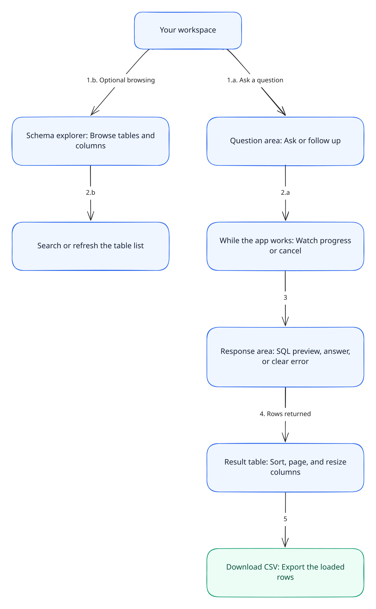

# Frontend and rendering

The browser renders schema metadata, conversation turns, and a bounded result snapshot. Server modules own database and model execution.

[Documentation home](./README.md) · [Architecture](./architecture.md) · [Database and results](./database.md)

**On this page:** [Render tree](#render-tree) · [Components](#views-and-component-responsibilities) · [State](#hooks-and-state-ownership) · [Editor](#sql-preview-editor) · [Accessibility](#accessibility-and-interaction) · [Manual UI](#retained-manual-query-ui)

## Render tree

[](../mermaid/rendered/02-frontend.svg)

Open the image at full size. Related views explain [results and follow-up history](../mermaid/rendered/11-results-and-history.svg) and [cancellation](../mermaid/rendered/09-cancellation-lifecycle.svg).

`src/app/layout.tsx` supplies the document shell, Geist font variables, global CSS, metadata, and skip navigation. The home route in `src/app/page.tsx` renders `AppEntry`, which provides the branded header and workspace frame.

`QueryWorkspace` is the top-level interactive view. It composes two largely independent concerns:

- `useDatabaseSchema` loads schema metadata for `SchemaExplorer`.
- `NaturalLanguageInput` owns the conversation UI and informs the workspace when generation is active, which disables schema refresh during a turn.

The active view hierarchy is:

```text
AppEntry
└── QueryWorkspace
    ├── SchemaExplorer
    └── NaturalLanguageInput
        ├── prior/current ConversationTurn
        │   ├── QueryPreview -> CodeEditor (dynamic import)
        │   ├── AgentResponse (dynamic import; Markdown)
        │   └── QueryResult -> ResultTable -> TableRow -> TableCell
        └── QueryPrompt
```

`src/app/error.tsx` is the route-level error UI. Workspace styling is in `src/components/query/queryAgent.module.css`; the global reset, font defaults, and skip-link styling are in `src/app/globals.css`.

## Views and component responsibilities

| Component               | Responsibility                                                                                                                                                              |
| ----------------------- | --------------------------------------------------------------------------------------------------------------------------------------------------------------------------- |
| `AppEntry`              | Server-renderable app chrome around the client workspace.                                                                                                                   |
| `QueryWorkspace`        | Connect schema refresh state and natural-language generation state without combining their fetch lifecycles.                                                                |
| `SchemaExplorer`        | Filter table and column metadata locally, group relations by schema, show loading/errors, and request refresh.                                                              |
| `NaturalLanguageInput`  | Coordinate the prompt, conversation turns, generation status, cancellation, New chat, and result rendering.                                                                 |
| `QueryPrompt`           | Controlled question draft, request-length bound, accessible description, and IME-safe Ctrl/Command+Enter submission.                                                        |
| `QueryPreview`          | Show provisional SQL as a read-only preview; format only completed SQL for display, preserving partial/error text verbatim.                                                 |
| `AgentResponse`         | Render streamed response text as Markdown with GFM support; remote images are replaced by alt text. Deferred rendering keeps stream updates from dominating urgent UI work. |
| `QueryResult`           | Present result status, warnings/errors, loaded-row count, snapshot CSV action, and empty-result state.                                                                      |
| `ResultTable`           | Render sortable/resizable columns, current page, and accessible pagination controls.                                                                                        |
| `TableRow`, `TableCell` | Memoized leaf renderers for visible rows and typed cell values.                                                                                                             |
| `WorkspaceIcon`         | Shared icon vocabulary for the workspace UI.                                                                                                                                |

The schema explorer's filtering is client-side over the schema response; it does not issue SQL. Result sort and pagination are likewise client-side over the at-most-1,000 rows returned by the server.

## Hooks and state ownership

| Hook                   | Owns                                                                                                                                                                                                                  |
| ---------------------- | --------------------------------------------------------------------------------------------------------------------------------------------------------------------------------------------------------------------- |
| `useAIQueryGeneration` | One active WebSocket turn, `AbortController`, progress, preview text, visible previous turns, bounded model history, cancellation, and reset. It uses controller identity checks to ignore stale callbacks.           |
| `useDatabaseSchema`    | Component-facing loading/error state and refresh trigger. It suppresses state updates after unmount without cancelling a shared request another subscriber may need.                                                  |
| `useQueryResultTable`  | TanStack Table state: typed scalar sorting, pagination, resizable column widths, and reset on new result.                                                                                                             |
| `useFileDownload`      | Build a CSV Blob from the current result snapshot and expose a scoped download error. It does not call the download HTTP API.                                                                                         |
| `useFetchQueryResults` | Legacy/manual HTTP execution lifecycle with cancellation-on-unmount, timeout, response validation, and error state. The hook is used by retained manual editor code; the active main view does not mount that editor. |

Visible conversation snapshots are separate from model history. The user can scroll older turns, while the history sent to the model is reduced to recent alternating question/answer messages, including all loaded rows per retained turn. Whole turns are removed to meet the protocol's length bounds; individual results are never sampled. Successful turns are added to model history; failed or cancelled turns can remain visible without being added to that history.

The reset action aborts any current request and clears both kinds of state. The visible New chat button is disabled during generation, so users cancel first. Unmount also aborts the active stream. There is no browser storage persistence or cap on the number of visible turns.

## Browser service modules

- `src/lib/client/queryStream.ts` owns WebSocket construction, outbound request framing, inbound event validation, the client-side timeout, animation-frame batching, and cleanup.
- `src/lib/client/clientApi.ts` owns uncached JSON fetching and response/error parsing.
- `src/lib/client/clientValidation.ts` validates external JSON structures before they enter React state.
- `src/lib/client/clientSchema.ts` coalesces schema loads and caches only successful responses in the browser module.
- `src/lib/client/downloadFile.ts` creates and revokes a temporary object URL for a browser download.
- `src/lib/shared/queryConversation.ts` builds the compact history representation shared by client and server.
- `src/lib/shared/queryResults.ts` centralizes scalar formatting, sorting, CSV escaping/formula neutralization, and table sizing limits.

## SQL preview editor

`QueryPreview` is statically imported; it dynamically imports `CodeEditor`. CodeMirror is created once per mounted `CodeEditor`, updated incrementally for appended stream text, and destroyed on unmount. `createEditorState` configures SQL language support, line numbers, selection, and read-only/non-editable accessibility attributes. The editor remains selectable and copyable. The stylesheet `codeEditorTheme.css` owns collapsed/expanded sizing and CSS variables; `codeEditorTheme.ts` maps CodeMirror syntax and surfaces to those variables.

After generation completes, `QueryPreview` formats PostgreSQL SQL for display only. If the SQL is partial, errored, or cannot be formatted, the original preview remains available. Formatting never changes the SQL sent to the database.

## Accessibility and interaction

These are implemented behaviors, not a claim of audited accessibility conformance:

- A skip link targets the main workspace. Named regions identify conversation, SQL preview, and results.
- The prompt supports Ctrl/Command+Enter and ignores the shortcut during input-method composition.
- Generation status uses `role="status"`; conversation busy state uses `aria-busy`.
- Sort buttons expose column order through `aria-sort`. Pagination announces the current page.
- Column resize handles support Left/Right arrows, Shift for a finer step, and Home to reset; pointer users can double-click to reset.
- SQL preview expansion exposes `aria-expanded` and `aria-controls`.
- Remote Markdown images become alt text, and result formatting distinguishes `NULL`, an empty string, `false`, and zero.

Keyboard focus, screen-reader announcements, zoom, and narrow layouts still need [manual browser checks](./testing-operations.md#browser-smoke-checks). Current automated tests exercise helpers and table behavior, not a complete rendered accessibility audit.

## Retained manual-query UI

`src/components/query/manual/ManualQueryEditor.tsx` and `QueryBox.tsx` are present but not imported into the active workspace. The editor uses `useFetchQueryResults` and `/api/post/query`, which execute a manually supplied SQL statement under the shared server-side read-only policy. This is a retained path, not a currently visible workspace feature.

## Data rendering constraints

- `QueryValue` preserves strings, numbers, booleans, and nulls; database numeric strings are not coerced to JavaScript numbers.
- Display formatting renders null as `NULL`; sorting uses numeric/boolean order where values share those types and text comparison otherwise.
- Sorting and pagination apply to loaded result rows, not the full matching database relation.
- UI CSV export represents the exact loaded snapshot in database order, regardless of current sort/page view.
- The answer Markdown renderer does not allow remote images to be loaded; image alt text is rendered instead.
