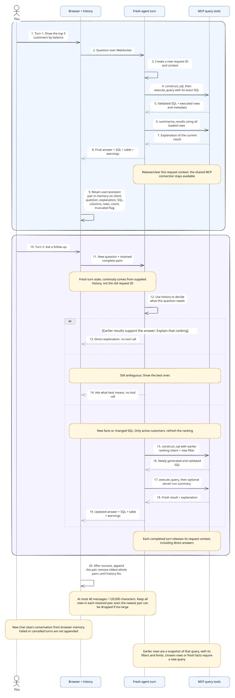
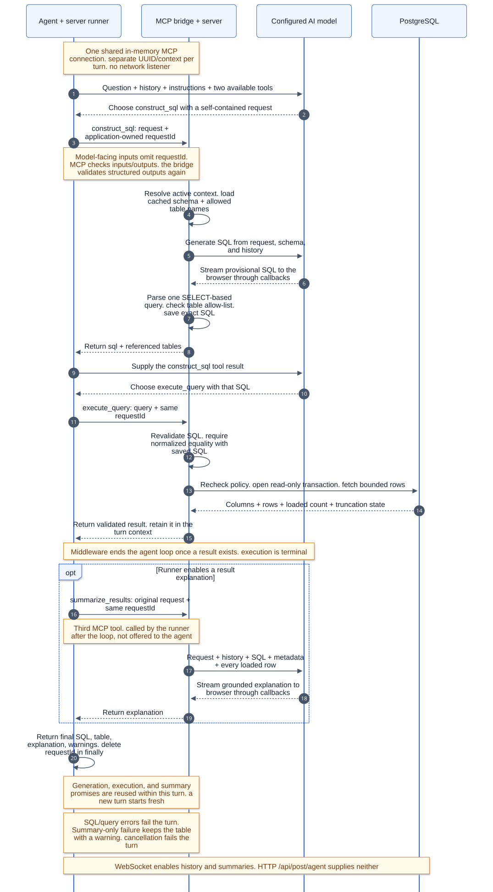

# MCP flow across query turns

Query Studio uses MCP (Model Context Protocol) to connect its LangChain agent to three typed query tools. The MCP client and server communicate through a linked in-memory transport inside the same Node.js process. AI-provider requests and PostgreSQL connections are separate network interactions.

[Documentation home](./README.md) · [Query agent implementation guide](./query-agent.md) · [Editable diagrams](../mermaid/README.md)

Read the diagrams in order: conversation behavior, tool execution, then safeguards. Open each SVG at full size to follow its labels and numbered messages.

## Follow a conversation across turns

The blue section follows an initial question through generation, execution, and explanation. The purple section shows the three choices available on a later turn. Tool selection is guided by the agent prompt: a new message does not require a database query by itself.

For example, after “Show the top five customers by balance,” these follow-ups have different needs:

| Follow-up                                    | Intended behavior                                    | Reason                                                    |
| -------------------------------------------- | ---------------------------------------------------- | --------------------------------------------------------- |
| “Explain that ranking”                       | Answer directly from retained SQL and results        | Earlier context supports the explanation                  |
| “Show the best ones”                         | Ask what “best” means if history does not resolve it | The ranking criterion is ambiguous                        |
| “Only active customers; refresh the ranking” | Construct and execute a new query                    | The filter changes and the user wants fresh results       |
| “How many customers are there overall?”      | Query the database again                             | A top-five snapshot cannot establish a full-dataset total |

When another query is needed, the model should give `construct_sql` a self-contained request that preserves relevant earlier filters, rankings, and intent. The model's interpretation remains prompt-guided; the server enforces the SQL checks described below.

The browser appends history only after a successful response, including direct answers and clarifying questions. Each saved pair contains the user's question and an assistant JSON message with explanation, SQL, column metadata, loaded count, truncation state, and all loaded rows. Failed or cancelled turns are not appended.

History is capped at **40 messages and 120,000 characters**. The browser drops oldest complete pairs until both limits are met; it does not sample rows to make a pair smaller. Even the newest pair is removed if it cannot fit. Visible results remain separately in browser state, so a table can still be on screen after its context has left model history. Current-result summarization uses all loaded rows independently of this history budget.

Each server turn gets a new context and UUID. It receives the retained history from the browser and releases its registry entry in `finally` when orchestration settles. The shared MCP connection does not retain conversation history. New chat clears browser history and visible turns; it does not reset the MCP connection or schema cache.

## Follow one turn through MCP

Read the numbered messages from top to bottom. “Agent + server runner” combines the model-driven tool loop with the application code that owns setup, optional summarization, and cleanup. “MCP bridge + server” combines the LangChain wrappers, MCP client/server transport, and registered tool handlers.

The model sees two tools. The third is registered with MCP but is called by the application after execution:

| Tool                | Caller and input             | Work and result                                                                                         |
| ------------------- | ---------------------------- | ------------------------------------------------------------------------------------------------------- |
| `construct_sql`     | Agent: `{ request }`         | Load cached schema, generate and validate SQL, record it, and return `{ sql, tables }`                  |
| `execute_query`     | Agent: `{ query }`           | Require the saved SQL, execute it, and return columns, rows, loaded count, truncation flag, and message |
| `summarize_results` | Server runner: `{ request }` | Explain the current executed result using all loaded rows and return `{ explanation }`                  |

The bridge adds an application-owned `requestId` to each MCP call. The tool handler uses that ID to find the active context containing the model, prompts, cancellation signal, callbacks, SQL, and results. Credentials and callbacks stay in the process. MCP validates tool inputs and outputs; the bridge checks returned structured content against the shared output schema again. The opaque ID isolates request state; it does not provide user authentication.

Construction reads the cached schema and builds a table allow-list. It sends the request, schema, and bounded history to the configured model. SQL tokens stream to the browser as a provisional preview; the completed SQL must pass syntax, statement-policy, and table-reference checks before construction succeeds. The query can express filters, joins, aggregates, rankings, or SELECT-based CTEs within that policy. Schema changes require a successful refresh to reach later generations.

Execution revalidates the supplied query and requires equality with the SQL recorded by construction after normalization. The database service checks SQL policy again, runs a read-only transaction, and returns at most 1,000 rows plus column metadata. Once a result exists, middleware ends the agent loop. If enabled, the runner calls `summarize_results` with the original question, history, and current result. SQL tokens and answer tokens use separate callbacks.

The context memoizes generation, execution, and summary promises. Repeated calls within that turn reuse work, including rejected generation/execution promises. A later turn starts with fresh promises and can query again. This is not a query-result cache across turns.

The WebSocket chat supplies history, requests summaries, and streams progress. The HTTP `/api/post/agent` endpoint accepts a question without forwarding history or requesting that extra summary. It also does not install the WebSocket turn deadline. See [Transport and APIs](./transport-api.md) for wire formats.

## Understand the safeguards and limits

Read each panel left to right. The first two describe request and database checks. The third bounds work and explains failure behavior. The fourth describes limitations that remain after those checks.

| Boundary              | Enforced behavior and practical limit                                                                                                                                                                                     |
| --------------------- | ------------------------------------------------------------------------------------------------------------------------------------------------------------------------------------------------------------------------- |
| Request and context   | WebSocket questions contain 1–10,000 characters; history must be valid alternating pairs within the message/character limits. MCP rejects inactive context IDs                                                            |
| SQL policy            | Accept one SELECT-based statement with recognized, allowed table references. Reject writes, schema changes, write-producing CTEs, `SELECT INTO`, row locks, and multiple statements                                       |
| Database execution    | Use a read-only transaction, fixed search path, 10-second statement timeout, and 3-second lock timeout. The database role determines accessible relations and functions                                                   |
| Model work            | Allow at most six agent-loop model calls; SQL generation and result summarization add separate calls. Automatic provider retries are disabled                                                                             |
| Time and cancellation | WebSocket turn deadline and each MCP call timeout are separately 180 seconds. Cancellation propagates cooperatively; active PostgreSQL work may continue until completion or its own timeout                              |
| Result coverage       | Return at most 1,000 loaded rows; `rowCount` is loaded count, not total matches. The cap does not bound query cost, column width, or total response bytes                                                                 |
| Answers and privacy   | Prompts require treating history, schema, and row values as data and avoiding unsupported conclusions. Model correctness is not guaranteed. Real-provider calls can include unredacted questions, schema, and loaded rows |

SQL-generation or query failure fails the turn. Generated SQL without execution is also an error; a direct answer must contain text. If only the optional summary fails while the turn is not cancelled, the final response keeps the successful table and includes a warning. Cancellation remains a failed/cancelled turn. Registry cleanup happens when orchestration settles, which can be later than the browser timeout or disconnect.

The public demo has no login or per-user access policies. SQL validation and read-only transactions protect its query path; they do not supply authentication, tenant isolation, or a general sandbox for database functions. See [Public demo and read-only safeguards](./security.md) for data handling and [Database and result data](./database.md) for SQL policy and cursor behavior.

## Find the implementation

| Responsibility                                  | Source                                                                                                                                           |
| ----------------------------------------------- | ------------------------------------------------------------------------------------------------------------------------------------------------ |
| Turn orchestration and optional summary         | [queryAgent.ts](../src/lib/server/agent/queryAgent.ts)                                                                                           |
| Tool choice and follow-up instructions          | [query-agent.md prompt](../src/lib/server/agent/prompts/query-agent.md)                                                                          |
| MCP registration and connection lifecycle       | [queryAgentMCP.ts](../src/lib/server/agent/queryAgentMCP.ts)                                                                                     |
| Model-facing wrappers and MCP result validation | [queryAgentTools.ts](../src/lib/server/agent/queryAgentTools.ts), [queryToolContracts.ts](../src/lib/server/agent/queryToolContracts.ts)         |
| Per-turn context and model-loop limits          | [queryRequestStore.ts](../src/lib/server/agent/queryRequestStore.ts), [queryAgentMiddleware.ts](../src/lib/server/agent/queryAgentMiddleware.ts) |
| Browser history and retained result context     | [useAIQueryGeneration.ts](../src/hooks/useAIQueryGeneration.ts), [queryConversation.ts](../src/lib/shared/queryConversation.ts)                  |
| SQL policy and database execution               | [sqlValidation.ts](../src/lib/server/database/sqlValidation.ts), [database.ts](../src/lib/server/database/database.ts)                           |
| WebSocket deadline and callbacks                | [querySocket.ts](../src/lib/server/transport/querySocket.ts)                                                                                     |

For provider configuration, prompt ownership, and detailed component contracts, continue with [Query agent and tools](./query-agent.md).
