# Query agent and tools

The server runs one agent turn per request. LangChain chooses between two query tools; a separate optional summary turns the executed result into prose.

[Documentation home](./README.md) · [Prompt authoring](../src/lib/server/agent/prompts/README.md) · [Public demo and read-only safeguards](./security.md)

**On this page:** [Orchestration](#per-turn-orchestration) · [Tools](#tool-contract-and-flow) · [SQL generation](#sql-generation-and-validation) · [Configuration](#provider-configuration-and-mock-model) · [History](#conversation-history) · [Failures](#cancellation-and-errors)

## Components

The agent implementation lives in `src/lib/server/agent/`:

- `agentConfig.ts` resolves provider credentials, model name, and development mock configuration.
- `modelFactory.ts` builds either a streaming Gemini/OpenAI LangChain chat model or the deterministic test/development model.
- `queryAgent.ts` composes the agent, middleware, MCP-backed tools, event forwarding, final result, optional summary, and request cleanup.
- `queryAgent.types.ts` defines request options and the mutable request-local context.
- `queryAgentMCP.ts` registers tool handlers on an in-memory MCP server and connects a shared client.
- `queryAgentTools.ts` bridges LangChain tools to MCP and validates tool results.
- `queryToolContracts.ts` is the shared Zod input/output contract for model-facing and MCP tools.
- `queryRequestStore.ts` maps opaque per-turn IDs to active request contexts.
- `queryAgentMiddleware.ts` caps model calls and stops the model loop after execution or tool failure.
- `generateSql.ts`, `executeQuery.ts`, and `summarizeResults.ts` implement tool behavior.
- `queryMessages.ts`, `queryPrompts.ts`, and `mocks/` provide message conversion, prompts, and deterministic mock behavior.

## Per-turn orchestration

Open the image at full size. See [instructions and model selection](../mermaid/rendered/12-prompts-and-models.svg) for what guides the AI.

The [illustrated MCP flow guide](./mcp-flow.md) explains the [multi-turn conversation](./mcp-flow.md#follow-a-conversation-across-turns), [MCP tool lifecycle](./mcp-flow.md#follow-one-turn-through-mcp), and [agent safeguards and limits](./mcp-flow.md#understand-the-safeguards-and-limits) with embedded diagrams, follow-up examples, and implementation links. It distinguishes enforced checks from prompt guidance; this page provides the component contracts and configuration details.

`runQueryAgent` validates the supplied history again, emits the `understanding` stage, constructs the configured model, reads prompt files, and obtains the shared MCP client. It creates a fresh request context holding the model, prompts, options, emitted/generated SQL, required tables, model-call count, and memoized tool promises. A UUID registry key is the only context reference sent through MCP; it is deleted in `finally`.

The LangChain agent is supplied two tools: `construct_sql` and `execute_query`. Its system prompt describes their order and coordination. Model stream events tagged `sql-generation` are not forwarded as assistant prose because SQL tokens use a separate callback. Other model text events are sent as `agent_token`. The middleware permits at most six model calls in the agent loop and ends the loop once the result exists. That budget excludes the SQL-generation and optional summary calls made inside tools. Tool failures are retained in the context and rethrown before another model iteration.

After the model loop:

- Generated SQL without an executed result is treated as an error.
- An answer-only turn can return a response with empty SQL and no result.
- An executed query produces the SQL, referenced tables, result, explanation, and truncation warning if applicable.
- If summaries are enabled, `summarize_results` is called explicitly after the model loop. This is an MCP tool, but it is not exposed to the LangChain agent's tool-calling loop.
- A non-cancellation summary failure keeps the successful table and appends a warning. Cancellation remains a failed/cancelled turn.

The WebSocket path enables summaries and passes bounded history and progress/token callbacks. The non-streaming `/api/post/agent` path does not pass history or enable an optional summary.

## Tool contract and flow

All input and output schemas live in `queryToolContracts.ts`, and are checked at MCP registration and again at the LangChain bridge. MCP adds an internal `requestId` to each schema; that ID is not part of the model-facing contract.

| Tool                | Input         | Behavior                                                                                                                                                                                                                      |
| ------------------- | ------------- | ----------------------------------------------------------------------------------------------------------------------------------------------------------------------------------------------------------------------------- |
| `construct_sql`     | `{ request }` | Loads cached schema text, builds an allow-list of schema-qualified and public unqualified table names, streams model-generated SQL, validates it, records the exact SQL and referenced tables, and returns `{ sql, tables }`. |
| `execute_query`     | `{ query }`   | Requires a non-empty generated SQL value and equality with the validated SQL returned by `construct_sql`; executes through the database service and returns columns, rows, count, truncation flag, and message.               |
| `summarize_results` | `{ request }` | Requires an executed result; sends all loaded rows (up to 1,000) plus result metadata to the model, streams assistant text, and returns `{ explanation }`. Invoked by the server orchestrator after agent execution.          |

Tool execution, SQL generation, and summary promises are memoized on the request context. Duplicate tool calls within one turn reuse the work, including a rejected generation/execution promise; they do not silently retry work.

The shared MCP connection uses an in-memory linked transport pair, not a network listener. It serves concurrent turns; the context ID isolates mutable state. The connection promise is shared and reset if setup fails, permitting a later retry. Tool descriptions are read from prompts during initial MCP setup, so changing those descriptions requires a server restart to affect the existing connection.

## SQL generation and validation

The generation operation:

1. Reads the current schema snapshot and derives table identifiers the agent may refer to.
2. Emits `generating_sql` and `sql_start`, then streams tokens.
3. Supplies the SQL-generation system prompt, bounded prior conversation, schema, and user's request as structured messages.
4. Validates the completed text with `cleanAndValidateSql`.
5. Saves the normalized SQL and parsed table references to the request context.

Prompt text distinguishes schema and user content as data. The one-pass prompt-template substitution prevents placeholder-like strings inside schema or user input from being recursively interpreted. Full prompt ownership and editing guidance are in [the prompt README](../src/lib/server/agent/prompts/README.md).

Execution repeats SQL policy checks and additionally requires the incoming SQL to match the generated SQL exactly after normalization. This prevents a model from replacing or rewriting the generated statement at the execution stage.

## Provider configuration and mock model

`getAgentConfig` reads server-side settings only. `AI_PROVIDER` supports `gemini` or `openai`; an explicit `AI_MODEL` takes precedence over `LANGCHAIN_MODEL` and provider defaults. Gemini keys are resolved from `AI_API_KEY`, `GEMINI_API_KEY`, then `GOOGLE_API_KEY`; OpenAI uses `OPENAI_API_KEY` then `AI_API_KEY`. The root README documents environment setup.

The model factory enables streaming, sets deterministic temperature zero, and disables automatic provider retries. Development mock mode substitutes `MockQueryChatModel`, uses a fixed SQL example, and still exercises agent tools, MCP, SQL validation, and real PostgreSQL execution. The custom server configures mock mode from development/CLI settings; production does not honor the mock flag.

## Conversation history

[`buildQueryResultContext`](../src/lib/shared/queryConversation.ts) includes explanation, SQL, columns, loaded-row count, truncation state, and all loaded `rows`. There is no row sampling or per-result character reduction; database execution caps loaded rows at 1,000.

`appendQueryHistory` stores a user prompt and this result context as an assistant JSON message. It removes oldest complete pairs until the 40-message and 120,000-character total limits are met. Every retained turn keeps all its loaded rows. If even the newest pair exceeds the total budget, that pair is removed too, without reducing its rows to fit.

[`useAIQueryGeneration`](../src/hooks/useAIQueryGeneration.ts) calls `appendQueryHistory` after a successful turn to prepare future history. Separately, [`summarizeResults`](../src/lib/server/agent/summarizeResults.ts) uses `buildQueryResultContext` directly to prepare the current result's `executedResult` model payload with an empty explanation. Current-result summarization includes every loaded row even when that payload exceeds the history budget. Neither use modifies the loaded table or snapshot CSV.

`parseQueryHistory` rejects non-arrays, oversized histories, odd message counts, incorrect user/assistant alternation, empty messages, and total content over the protocol limit. Full visible results remain in browser React state, not the history sent back to the model.

## Cancellation and errors

An AbortSignal is carried from the socket lifecycle through LangChain, MCP tool calls, model streaming, and database-operation checkpoints. MCP and browser cancellation signals are combined for tool handlers. Model/provider cancellation is cooperative; an active PostgreSQL statement is governed by its database timeout rather than an immediate cancel command. See [database cancellation behavior](./database.md#query-execution).

The request registry entry is disposed in `finally` when orchestration settles. A timeout event or socket close can precede that settlement; it does not prove all downstream work has already stopped. The agent logs unexpected failures and propagates errors to the WebSocket/API. A non-cancellation summary failure preserves the table with a warning. Provider retries are disabled, and failed generation/execution promises are reused within the turn rather than retried.

The non-streaming HTTP agent handler does not install the socket's AbortController or 180-second deadline. Do not assume the WebSocket lifecycle limits apply to every caller of `runQueryAgent`.
