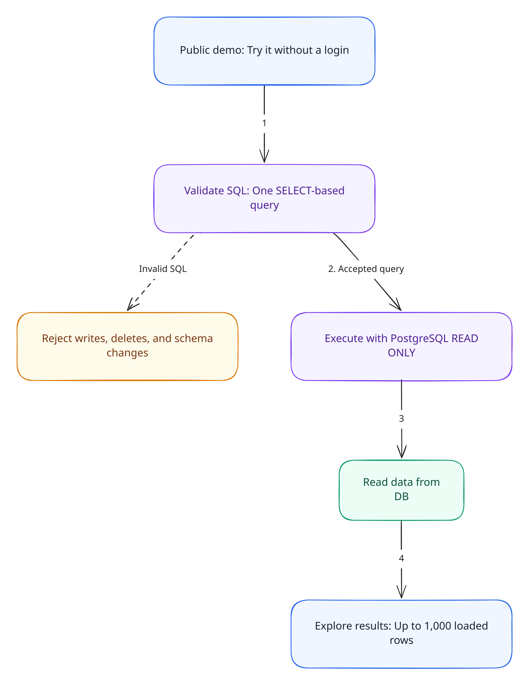

# Public demo and read-only safeguards

Query Studio is intentionally available without a login so anyone can try the idea and explore its usability. The public demo uses seeded demonstration data and focuses on asking questions, inspecting SQL, and exploring results. Account management and per-user access policies are outside this demo's scope.

[Documentation home](./README.md) · [Architecture](./architecture.md) · [Database and result data](./database.md)

## Read-only query safeguards

The query path has two layers that protect the demo data:

1. **Validate SQL before execution.** [`cleanAndValidateSql`](../src/lib/server/database/sqlValidation.ts) accepts a single SELECT-based query and rejects writes, deletes, schema changes, write-producing CTEs, `SELECT INTO`, and row-locking clauses. The agent also checks table references against the connected schema and executes exactly the SQL it generated and validated.
2. **Execute inside a read-only transaction.** [`executeDatabaseQuery`](../src/lib/server/database/database.ts) sets `SET TRANSACTION READ ONLY` before running the query, so PostgreSQL enforces read-only access to the queried tables. The chat, manual query API, and CSV download API share this execution path.

Queries also have a 10-second statement timeout, a 3-second lock timeout, and a 1,000-row return limit. These keep demo requests bounded; see [query execution](./database.md#query-execution) for the details.

These safeguards apply to the app's query path. Dataset seeding is a separate administrative operation that intentionally writes or replaces demo data. The configured PostgreSQL role determines which tables and functions are available.

## Data sent to the model provider

In real-provider mode, Gemini or OpenAI receives the question, relevant schema metadata, and all loaded rows used for the result explanation (up to 1,000). Follow-up history includes all rows for each retained turn, within the existing conversation budget. The demo data is intended to be explored publicly; no row sampling or redaction is applied.

Database credentials and model API keys stay on the server. Development mock mode avoids provider calls while still querying PostgreSQL. See [result context](../README.md#result-rows-sent-to-the-model) and [mock model behavior](./query-agent.md#provider-configuration-and-mock-model).
