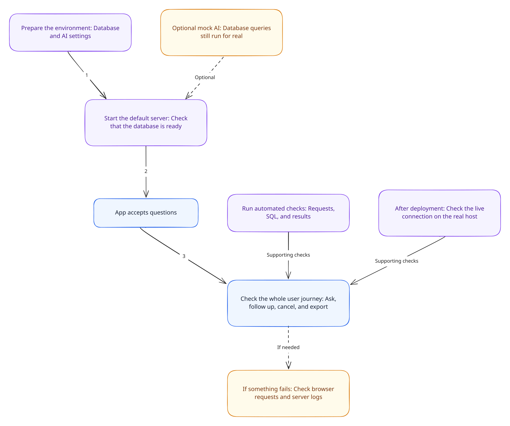

# Testing and operations

Use this guide to choose checks, understand startup and deployment differences, and diagnose runtime failures. Installation and environment setup live in the [project README](../README.md).

[Documentation home](./README.md) · [Transport and APIs](./transport-api.md) · [Public demo and read-only safeguards](./security.md)

**On this page:** [Tests](#test-map) · [Browser checks](#browser-smoke-checks) · [Runtime](#local-runtime) · [Production](#production-custom-server) · [Platform adapter](#alternate-platform-deployment) · [Troubleshooting](#troubleshooting) · [Docs checks](#documentation-checks)

## Test map

The project uses Node's built-in test runner through `node --import tsx --test`. Important suites include:

| Test file                                                                            | Focus                                                                                                                                             |
| ------------------------------------------------------------------------------------ | ------------------------------------------------------------------------------------------------------------------------------------------------- |
| `tests/moduleBoundaries.test.ts`                                                     | Browser/shared/server import-boundary enforcement.                                                                                                |
| `tests/queryStreaming.test.ts`, `querySocket.test.ts`, `queryHttpServer.test.ts`     | Client/server event flow, socket lifecycle, custom upgrade routing, and HTTP server integration.                                                  |
| `tests/queryMcp.test.ts`, `queryConversation.test.ts`, `mockModel.test.ts`           | Tool registration/contract, request history, and deterministic model behavior.                                                                    |
| `tests/sqlValidation.test.ts`                                                        | SQL parser and read-only/table-reference policy.                                                                                                  |
| `tests/databaseSchema.test.ts`, `databaseInitialization.test.ts`, `database.test.ts` | Schema metadata/cache, startup initialization, and PostgreSQL query behavior.                                                                     |
| `tests/clientSchema.test.ts`                                                         | Browser schema cache and refresh behavior.                                                                                                        |
| `tests/manualQuery.test.ts`                                                          | Static manual-query fixture pagination and CSV reconstruction, not the live HTTP path.                                                            |
| `tests/reactReview.test.ts`                                                          | Payload validators, scalar/CSV helpers, browser stream doubles, origin checks, and TanStack table configuration; no DOM-mounted React components. |

`tests/databaseMock.ts` supplies database doubles. Most suites run without a database or provider key. The opt-in live PostgreSQL test in `database.test.ts` uses `DATABASE_TEST_URL` and skips when it is not configured. It runs and commits the ecommerce seed, so use a disposable database with schema/insert privileges. The Node test command does not explicitly load `.env`; export `DATABASE_TEST_URL` in the test process environment.

`tests/fixtures/` contains static schema/manual-query fixture data; production schema metadata comes from PostgreSQL catalogs. Provider behavior in automated streaming tests is simulated, not proof of live provider compatibility. Route rejection tests do not establish that the platform WebSocket upgrade works on a deployed host.

Run from the repository root:

```bash
npm test
npm run lint
npx tsc --noEmit --incremental false
npm run build
```

Focused npm scripts are listed in `package.json`, including SQL, database, MCP, stream, manual-query, and mock-model suites. VS Code tasks and launch configurations are in `.vscode/tasks.json` and `.vscode/launch.json`; update their explicit test-file lists when adding suites.

Run one file or a named test when investigating a specific behavior:

```bash
node --import tsx --test tests/clientSchema.test.ts
node --import tsx --test --test-name-pattern='failed explicit refresh' tests/databaseSchema.test.ts
```

Passing unit tests, type checks, and a build do not establish browser accessibility, proxy behavior, or live database/provider connectivity. Use the checks below for those boundaries.

## Browser smoke checks

With a reachable database and either a provider key or ecommerce mock mode:

1. Open the workspace; confirm schema loading, local filtering, and refresh work.
2. Submit a question that names a relation in the schema. Confirm status, provisional SQL, streamed response, and the final table appear.
3. Ask a follow-up referring to the previous result; confirm context is retained.
4. Cancel an in-progress turn; confirm the UI becomes usable and partial output is not presented as a completed result. Start another turn to check for stale updates.
5. Sort and page results, resize a column with pointer and keyboard, then download CSV. The file should contain all loaded rows in original result order.
6. Exercise zero-row and truncated results. Confirm the UI distinguishes them from errors and never labels loaded rows as a total match count.
7. Start a new chat, then reload the page. Conversation state should clear; a reload should load schema into a fresh browser module cache.
8. Check keyboard-only navigation, prompt submission, focus visibility, status announcements, zoom, and a narrow viewport. Include long SQL, wide tables, and long Markdown answers.

Mock mode checks the local flow with fixed SQL. It does not test arbitrary question interpretation, another schema, or a real provider's API.

## Local runtime

[](../mermaid/rendered/07-testing-operations.svg)

Open the image at full size for the setup, verification, and troubleshooting flow.

The app runs from the repository root because runtime prompt and catalog SQL paths are resolved relative to `process.cwd()`. `npm run dev` and `npm start` invoke `server.ts`. Startup sequence:

1. Configure mock mode for development.
2. Prepare Next.js.
3. Authenticate the PostgreSQL pool and warm schema metadata.
4. Start the custom Node HTTP server with WebSocket upgrades enabled.

`next.config.ts` traces runtime `.md` prompt files and the catalog `.sql` file into production functions, and bundles `dt-sql-parser`. Keep those assets in the expected paths and preserve this tracing configuration when moving them.

The root README is authoritative for environment variable names, provider defaults, Compose datasets, seeding, quick start, and troubleshooting. Do not duplicate secrets in documentation. `env.example` is the checked-in configuration template.

`compose.yaml` supplies the local PostgreSQL services. `scripts/seed-database.ts`/`scripts/seed.sql` provision the ecommerce demo database, while `scripts/populate-test-db.sql` initializes or explicitly replaces the banking demo schema. These are destructive to the target demo schema only where documented; verify the selected database before running seed commands.

## Production custom server

Build and launch from the repository root with server environment variables available:

```bash
npm run build
npm start
```

The custom server requires Node.js, installed runtime dependencies including `tsx`, `.next` build output, and the source/assets loaded at runtime. Preserve the prompt and catalog SQL paths. Build success does not authenticate the database or exercise a live model; startup warms the database separately, and the first real turn validates model configuration.

Configure a reverse proxy to preserve the expected Host and Origin relationship and forward WebSocket upgrades. Its connection timeout must allow the application's 180-second turn window. Re-run the [browser smoke checks](#browser-smoke-checks) through the deployed proxy.

Each process can create a pool of up to 10 connections per database URL. Budget PostgreSQL capacity for the number of instances and overlapping restarts. Caches and the MCP connection are local to each process.

Restart after environment changes or edits to MCP tool descriptions. Prompt files are read each turn, but shared MCP tool descriptions are captured when the connection is created.

There is no dedicated health/readiness route, metrics pipeline, or automatic graceful-shutdown/draining handler in `server.ts`. A `closeQueryMcpConnection` helper exists for explicit teardown, but startup does not register signal handlers that invoke it or close pools. Do not describe that lifecycle as implemented operational behavior.

## Alternate platform deployment

The App Router `/api/agent/stream` route is an alternate Vercel-style WebSocket adapter. It uses the same socket handler and configured application deadline, but its hosting and upgrade lifecycle differ from the custom Node server. Validate it independently, including origin/host forwarding, resource cleanup, runtime support, and limits. Do not assume a successful `npm run build` proves a platform's WebSocket adapter works in production.

This path does not run the custom server's startup initialization or mock-flag setup. Database access and schema loading occur on demand. The route declares `runtime = "nodejs"`, dynamic execution, and `maxDuration = 300`; the shared socket handler still uses 180 seconds. Actual hosting support for the experimental adapter must be checked in the target environment.

## Troubleshooting

| Symptom                              | Check first                                             | Next action                                                        |
| ------------------------------------ | ------------------------------------------------------- | ------------------------------------------------------------------ |
| Server never listens                 | Startup logs, database URL, TLS, connectivity           | Verify the role can authenticate and read catalog metadata         |
| Missing or stale relations           | Role privileges and schema cache                        | Refresh in the UI; refresh/restart other instances separately      |
| WebSocket fails to connect           | Host/Origin match and proxy upgrade forwarding          | Inspect the browser handshake and server socket logs               |
| Turn times out                       | Application deadline, provider latency, pool contention | Separate model latency from database statement/lock timeouts       |
| Provider rejects a request           | Key precedence, provider, explicit model override       | Correct configuration and restart; retries are disabled            |
| Mock query fails                     | Ecommerce `public.customers` relation                   | Seed the ecommerce demo; mock SQL does not adapt to banking        |
| Table has only 1,000 rows            | `truncated` and warning fields                          | Narrow the SQL; paging cannot fetch additional rows                |
| CSV differs from current table order | Snapshot export versus server download                  | Browser export uses original loaded order; HTTP export re-executes |

Use browser Network inspection for request/response failures and server console output for startup, socket, and agent errors. There is no per-request tracing dashboard. Avoid copying credentials, full row contents, or unredacted provider errors into shared diagnostics.

## Documentation checks

For documentation-only changes, verify formatting and links, check factual claims against the owning modules, and inspect a rendered Markdown preview. Application builds and live database reseeding are not necessary solely for prose edits.

```bash
npx --no-install prettier --check 'docs/**/*.md'
```

Use `--write` instead of `--check` to apply the repository's installed formatter. Then verify:

- Relative page, source, image, and heading links resolve, including filename case.
- Each page has one title, an ordered heading hierarchy, and labeled code fences.
- Tables remain readable and code blocks scroll without forcing the whole page wider.
- The architecture SVG loads and its adjacent text explains the same flow.
- Content remains understandable at narrow widths and without diagram colors.
- Examples match runtime types and do not imply authentication, immediate SQL cancellation, or platform support the code does not provide.
