# Transport and APIs

The active workspace uses one WebSocket connection per turn. HTTP endpoints also expose schema reads, a non-streaming agent, manual SQL, and server-generated CSV.

[Documentation home](./README.md) · [Query agent](./query-agent.md) · [Public demo and read-only safeguards](./security.md)

**On this page:** [Adapters](#websocket-adapters) · [Limits](#socket-lifecycle-and-limits) · [Events](#websocket-event-protocol) · [HTTP reference](#http-api-reference) · [Errors](#http-validation-and-errors) · [Examples](#request-and-response-examples)

## WebSocket adapters

[](../mermaid/rendered/05-transport-api.svg)

Open the image at full size, or follow the [message sequence for one data question](../mermaid/rendered/08-end-to-end-sequence.svg).

Both supported WebSocket entry points use `handleQuerySocket`, so request parsing, cancellation, timeout, and agent event behavior are shared:

1. **Custom Node server** — `server.ts` prepares Next and passes its request handler to `createQueryHttpServer`. `queryHttpServer.ts` owns a `ws` `WebSocketServer` in `noServer` mode. It routes only `/api/agent/stream` upgrades to that server and forwards other upgrades to Next's separate upgrade server. The query endpoint requires a matching same-host `Origin` and host header.
2. **Platform route** — `src/app/api/agent/stream/route.ts` checks origin and the WebSocket upgrade header, then hands the shared handler to Vercel's experimental WebSocket adapter. The route uses the Node runtime, is dynamic, and declares a five-minute platform maximum; the shared handler still imposes the shorter application deadline.

Keep both adapters aligned when changing protocol behavior. A deployment platform must support its adapter; a reverse proxy in front of the custom server must forward upgrade requests.

## Socket lifecycle and limits

`handleQuerySocket` handles only the first message per connection and ignores subsequent messages. It parses JSON, validates a non-empty request of at most 10,000 characters, parses optional bounded history, resolves database and model config, and runs the agent with an AbortController.

| Limit                       | Value                                           | Owner                                        |
| --------------------------- | ----------------------------------------------- | -------------------------------------------- |
| Request length              | 10,000 UTF-16 code units before server trimming | `MAX_REQUEST_LENGTH`                         |
| History                     | 40 messages; 120,000 total content code units   | `MAX_HISTORY_MESSAGES`, `MAX_HISTORY_LENGTH` |
| Inbound WebSocket message   | 788,192 bytes                                   | `MAX_REQUEST_PAYLOAD_BYTES`                  |
| Server turn deadline        | 180 seconds from socket handler setup           | `AGENT_TIMEOUT_MS`                           |
| Browser stream deadline     | 185 seconds                                     | `queryStream.ts`                             |
| Combined SQL/answer preview | 1,000,000 UTF-16 code units in the browser      | `MAX_STREAM_TEXT_LENGTH`                     |

History must contain complete, non-empty user/assistant pairs. The byte allowance accounts for JSON escaping; string length limits use JavaScript `.length`, not bytes or user-perceived characters.

Close, error, deadline, and cancellation paths clear timers and signal cancellation. Database cancellation is [cooperative](./database.md#query-execution). The client settles only once, removes event listeners, cancels a pending animation frame, clears its timer, and closes its socket. There is no automatic reconnection or resume of a partially completed turn.

## WebSocket event protocol

The constants and progress-type guard are defined in `src/types/queryProtocol.ts`. The server emits JSON text events:

| Event           | Shape                                              | Meaning                                              |
| --------------- | -------------------------------------------------- | ---------------------------------------------------- |
| Progress        | `{ "type": "progress", "stage": QueryProgress }`   | Update status text in the UI.                        |
| SQL start       | `{ "type": "sql_start" }`                          | SQL generation is beginning.                         |
| SQL token       | `{ "type": "token", "token": string }`             | Provisional SQL text, separate from assistant prose. |
| Assistant token | `{ "type": "agent_token", "token": string }`       | Streamed answer/summary text.                        |
| Result          | `{ "type": "result", "result": QueryAgentResult }` | Final validated agent result.                        |
| Error           | `{ "type": "error", "error": string }`             | User-visible failure.                                |

The browser validates message type, progress values, payload strings, and final result structure. It batches token updates at most once per animation frame. Final generated SQL fills the preview only when no SQL tokens arrived; provisional SQL remains useful when a request fails partway through.

`QueryProgress` is one of `understanding`, `generating_sql`, `fetching_data`, or `summarizing`. A turn does not have to visit every stage: an answer-only response may contain no SQL or table. Clients should treat `result` or `error` as terminal and a close without either as failure. Tokens are provisional; partial text is not a successful result.

## HTTP API reference

| Method and path             | Request       | Successful response                                          |
| --------------------------- | ------------- | ------------------------------------------------------------ |
| `GET /api/database/schema`  | None          | Cached `{ tables }`; `Cache-Control: no-store`               |
| `POST /api/database/schema` | None          | Refresh metadata, then return `{ tables }`                   |
| `POST /api/post/agent`      | `{ request }` | `QueryAgentResult`; no forwarded history or optional summary |
| `POST /api/post/query`      | `{ query }`   | `DatabaseQueryResult`                                        |
| `POST /api/post/download`   | `{ query }`   | CSV attachment from a new execution                          |

All successful HTTP responses use status 200. Send JSON bodies with `Content-Type: application/json`. Handlers are under [`src/pages/api`](../src/pages/api/). The [WebSocket protocol](#websocket-event-protocol) uses `/api/agent/stream` and is separate from this HTTP reference.

The client currently uses the WebSocket path for the main query flow. `useFetchQueryResults` uses the query endpoint for retained manual-query UI. The browser's Download CSV button exports its current result snapshot directly and does not call the download endpoint.

## HTTP validation and errors

Pages API handlers restrict methods, validate required body strings, apply same-host origin checks when an `Origin` header is present, and return JSON errors for failed requests. Schema GET is read-only and does not reject a supplied cross-origin `Origin`; schema POST checks it because it changes the process cache.

Application errors use `{ "error": "message" }`. Status mapping differs by endpoint:

| Status | When returned                                                                                      |
| ------ | -------------------------------------------------------------------------------------------------- |
| `400`  | Invalid agent request; missing manual SQL; manual SQL validation, connection, or execution failure |
| `403`  | A checked Origin does not match Host                                                               |
| `405`  | Unsupported HTTP method; handlers also set `Allow`                                                 |
| `500`  | Non-streaming agent configuration or execution failure                                             |
| `503`  | Schema loading or refresh failure                                                                  |

Next.js or a proxy can return other statuses or non-JSON bodies before a handler runs. Ordinary HTTP requests to the platform stream adapter receive `403` for a missing/mismatched Origin, or `426` when Origin is accepted but no WebSocket upgrade was requested. Custom-server upgrade rejections destroy the socket rather than returning this JSON error contract.

The browser's `fetchJson` reads JSON explicitly, rejects malformed JSON and non-2xx responses, and provides a fallback error when an API error body is missing or invalid. Schema and result payloads are parsed by `clientValidation.ts` before use.

The WebSocket paths require a present same-host origin. These checks are for browser cross-site request protection only; they do not authenticate the caller. The non-WebSocket Pages API routes do not require an Origin header from non-browser clients.

HTTP handlers do not install the socket's overall deadline or abort work on client disconnect. Browser schema and retained manual requests have 30-second client timeouts, which do not guarantee cancellation on the server. Manual SQL strings have no application-specific length bound; the WebSocket payload cap does not apply to them.

## Request and response examples

With a running local server, read the cached schema:

```bash
curl --fail-with-body http://localhost:3000/api/database/schema
```

Ask the HTTP agent to generate and execute a query using your connected schema:

```bash
curl --fail-with-body http://localhost:3000/api/post/agent \
  --header 'Content-Type: application/json' \
  --data '{"request":"Count rows in a table from the connected schema"}'
```

A WebSocket client sends a single JSON message after connection opens. Omit history for the first turn:

```json
{
  "request": "Show 10 customers ordered by customer_id"
}
```

The following is an illustrative final event, assuming an ecommerce database. Values and explanation text vary with the query and provider:

```json
{
  "type": "result",
  "result": {
    "generatedSQL": "SELECT customer_id FROM public.customers ORDER BY customer_id LIMIT 10;",
    "explanation": "The query returned one customer.",
    "requiredTables": ["public.customers"],
    "warnings": [],
    "queryResult": {
      "columns": ["customer_id"],
      "rows": [{ "customer_id": "ALFKI" }],
      "rowCount": 1,
      "truncated": false,
      "message": "Query executed successfully against PostgreSQL."
    }
  }
}
```

`queryResult` is absent for an answer-only turn, which has empty `generatedSQL` and a non-empty explanation. For follow-ups, pass alternating `QueryChatMessage` pairs in `history`; use [the conversation helper](../src/lib/shared/queryConversation.ts) to build bounded context with all loaded rows per retained turn.

## Request and response types

`src/types/query.types.ts` defines query results, values, rows, agent results, and history messages. `src/types/databaseSchema.types.ts` defines schema/table/column metadata. `src/types/queryProtocol.ts` defines cross-runtime limits and progress stages. Keep these types and runtime validators aligned whenever the wire protocol changes.

## Public demo behavior

The demo intentionally allows visitors to try these endpoints without logging in. Chat, manual queries, and SQL-based CSV downloads share the same SQL validation and read-only execution safeguards. See [public demo and read-only safeguards](./security.md) for details.
